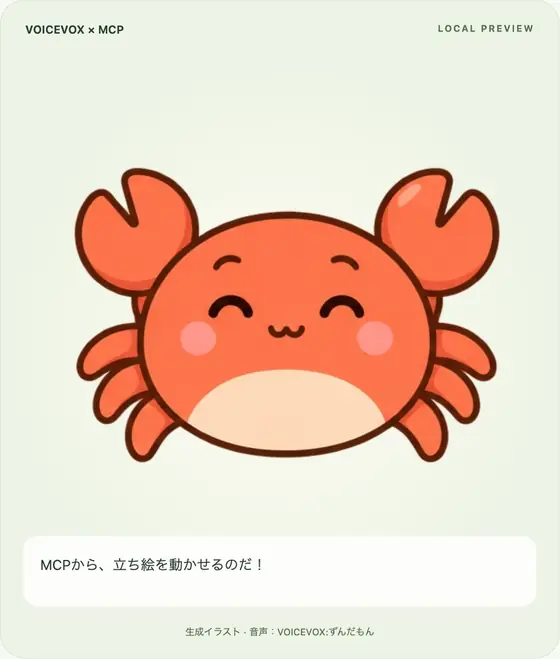
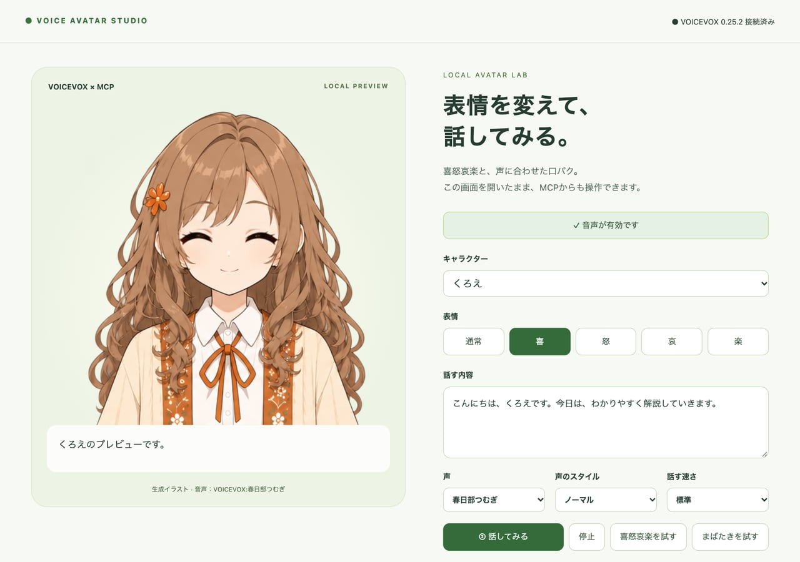
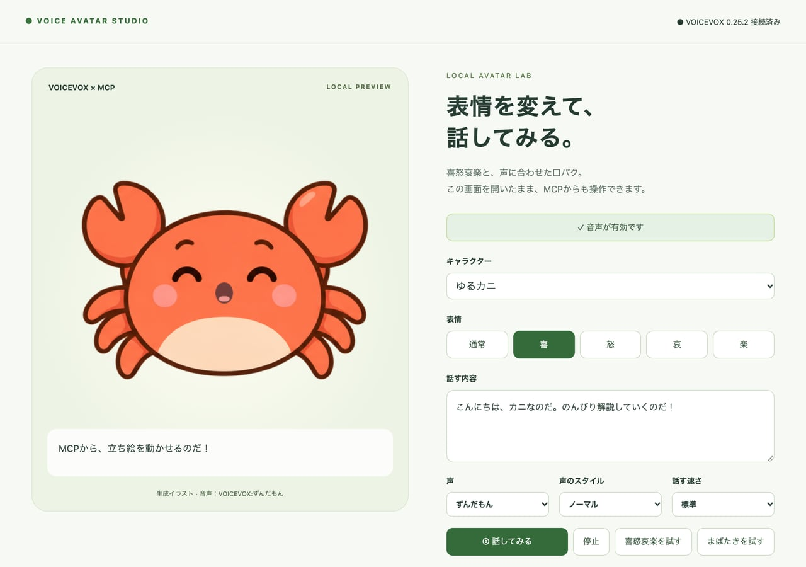
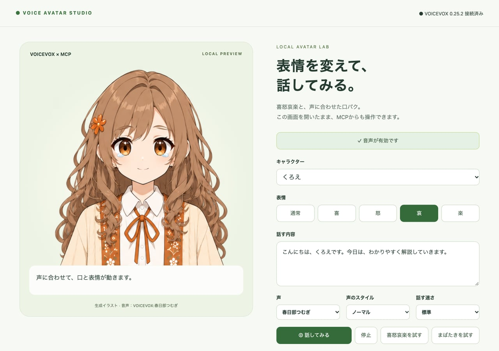
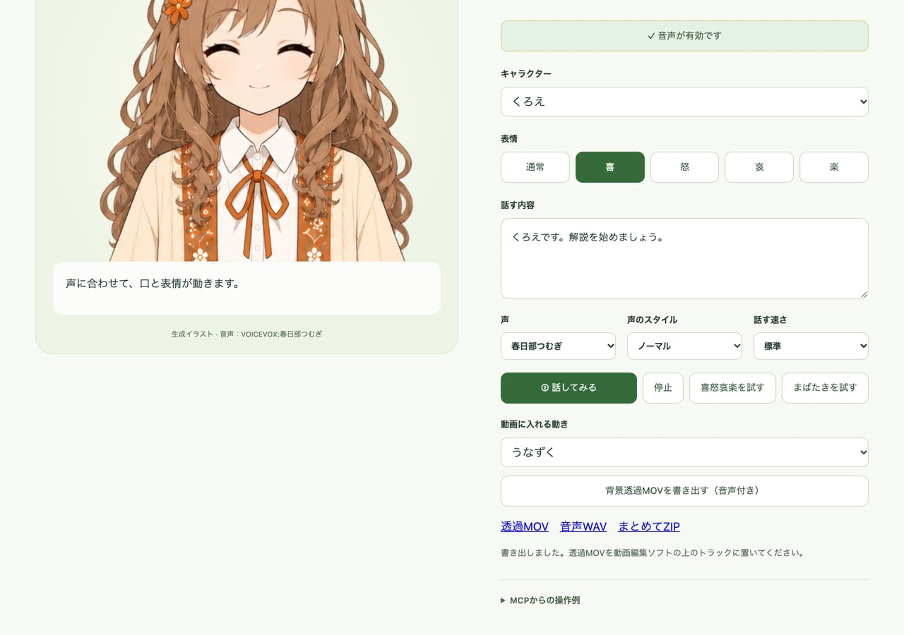

# VOICEVOX Avatar Studio

VOICEVOX の声に合わせて、立ち絵に口パク・まばたき・喜怒哀楽を付けて動かす、ローカルのスタジオと MCP サーバー。

[](https://openai.com/codex/)
[](https://www.anthropic.com/claude)
[](./LICENSE)

<p align="center">
  
</p>

**Codex（gpt-6.1-sol・MEDIUM）** で作り、**Claude Code × Claude Opus 5.5（HIGH）** で公開に向けて整えました。

ブラウザの画面で試せるほか、MCP サーバーとして Claude や Codex から話させたり、2 人を順番に話させたりできます。解説動画に重ねる背景透過の動画も書き出せます。

> **非公式のツールです。** VOICEVOX、および各キャラクターの公式・権利者とは関係ありません。

## スクリーンショット

<table>
  <tr>
    <td width="50%"><br><sub>くろえ（声は春日部つむぎ）。右側でキャラ・表情・声・話す速さを選びます。</sub></td>
    <td width="50%"><br><sub>ゆるカニ（声はずんだもん）が、MCP から届いたセリフを話しているところ。</sub></td>
  </tr>
  <tr>
    <td width="50%"><br><sub>表情は通常・喜・怒・哀・楽の 5 つ。差し替わるのは目のまわりだけです。</sub></td>
    <td width="50%"><br><sub>背景透過の MOV を書き出したところ。WAV と ZIP も一緒に保存します。</sub></td>
  </tr>
</table>

画像と動画は、すべて実際の画面です（撮影では音を鳴らさず、口パクの時刻を撮影用の時計に合わせて 1 コマずつ撮っています）。

## 特徴

- 立ち絵は 3×2 の表情シート 1 枚（通常・喜・怒・哀・楽・まばたき）。体や髪は通常の絵に固定し、目のまわりだけを差し替えます。
- 口は VOICEVOX の音声クエリの母音に合わせてコードで描きます。時刻は最後に実際の WAV の長さへ合わせるので、長い文でもずれが溜まりません。
- 見た目と声は別々に選べます（例：カニの見た目にずんだもんの声）。
- 同梱の立ち絵は、オリジナルキャラクターの **くろえ** と **ゆるカニ** の 2 人です。

## 必要なもの

- [Node.js](https://nodejs.org/) 22.2 以上（v25 で確認）
- [VOICEVOX](https://voicevox.hiroshiba.jp/)（起動しておく。既定の接続先は `http://127.0.0.1:50021`）
- [FFmpeg](https://ffmpeg.org/)（背景透過の動画を書き出すときだけ）

## まず試す

```sh
npm ci
npm start
```

ブラウザで http://127.0.0.1:3210 を開き、「① 音声を有効にする」→「② 話してみる」を押します。最初の「音声を有効にする」は、ブラウザの自動再生の制限に対応するためのものです。macOS では `start.command` をダブルクリックしても起動できます。

## 立ち絵を用意する

`public/characters.json` に 6 人分の枠があります。立ち絵の画像があるキャラだけが選べます（ない場合は画面に「立ち絵なし」と出ます）。

| id | キャラクター | 初期の声 | 立ち絵 |
|---|---|---|---|
| `kuroe` | くろえ（オリジナル） | 春日部つむぎ | 同梱 |
| `crab` | ゆるカニ（オリジナル） | ずんだもん | 同梱 |
| `zundamon` | ずんだもん | ずんだもん | 各自で用意 |
| `metan` | 四国めたん | 四国めたん | 各自で用意 |
| `tsumugi` | 春日部つむぎ | 春日部つむぎ | 各自で用意 |
| `kiritan` | 東北きりたん | 東北きりたん | 各自で用意 |

VOICEVOX のキャラクターの立ち絵は同梱していません。作者が試作に使った生成イラストは、各キャラクターのガイドラインに AI 生成画像についての記載がなく、再配布してよいかがはっきりしないためです。使う場合は、各キャラクターのガイドラインに沿った画像を自分で用意し、`public/assets/<id>.png` に置いてください。試作で使った生成プロンプトは [IMAGE-PROMPTS.md](IMAGE-PROMPTS.md)・[IMAGE-PROMPTS-ADDED.md](IMAGE-PROMPTS-ADDED.md) にあります（くろえ・ゆるカニの分は [IMAGE-PROMPTS-ORIGINAL.md](IMAGE-PROMPTS-ORIGINAL.md)）。

同梱のくろえは、喜と楽の絵の差が小さめです（ゆるカニははっきり違います）。

**表情シートの形**

- 1536×1024 の PNG（背景透過）。512×512 のマスを横 3 × 縦 2 に並べる。
- マスの順番：上の段が左から通常・喜・怒、下の段が左から哀・楽・まばたき。
- 6 マスで体・髪・口の位置をそろえ、変えるのは目と眉だけにする。口は閉じた小さな口にしておく（口パクはコードで上から描きます）。

**顔の位置（`characters.json` の `face`）**

| キー | 意味 |
|---|---|
| `eyes`, `eyeY` | 左右の目の中心の x と、目の高さ y（512×512 のマスの中の座標） |
| `rx`, `ry` | 目のまわりを差し替える楕円の半径 |
| `offsets` | 各マスの絵が通常の絵からずれているときの補正 `[dx, dy]`（6 マスぶん） |
| `mouthX`, `mouthY`, `mouthRx`, `mouthRy` | 口の中心と、口を描く前に肌色で塗る範囲 |
| `skin` | 口のまわりの肌の色 |

画像を差し替えたら `npm run test:renderer` で、表情を変えても目のまわり以外が変わらないことを確かめられます。

## MCP サーバーとして登録する

MCP は `mcp.mjs`（STDIO）です。表示用のサーバーは、必要なときに自動で起動します。

**Claude Desktop**：`claude_desktop_config.json`（設定 → 開発者 → 設定を編集）の `mcpServers` に、[claude-desktop-config.example.json](claude-desktop-config.example.json) の `avatar-studio` を足して、アプリを再起動します。`<このフォルダの絶対パス>` は書き換えてください。アプリから `node` が見つからない場合は、`command` に `which node` の結果（絶対パス）を書きます。

**Codex**：[codex-config.example.toml](codex-config.example.toml) のブロックを `~/.codex/config.toml` に足すか、次のコマンドで登録します。

```sh
codex mcp add avatar-studio -- node "<このフォルダの絶対パス>/mcp.mjs"
```

ブラウザで表示画面を開いて音声を有効にしておくと、次のように頼めます。

> カニを嬉しい表情にして「うまくつながったのだ！」と話して。

### ツール

| ツール | 用途 |
|---|---|
| `avatar_status` | VOICEVOX の接続、表示画面、音声の許可、直近の再生結果、順番待ちの数 |
| `avatar_characters` | キャラの一覧（立ち絵の場所 `spritePath`・立ち絵があるか・`face`・表情シートの形・声のクレジット） |
| `avatar_character` | キャラを選ぶ（声もそのキャラの初期の声になる） |
| `avatar_voice` | 見た目はそのままで声だけ選ぶ |
| `avatar_emotion` | `neutral` / `happy` / `angry` / `sad` / `joy` |
| `avatar_speak` | 話す。`text` のほか `character`・`voice`・`emotion`・`style`・`speed`・`queue`・`wait` |
| `avatar_stop` | 発話と口パクを止め、順番待ちも取り消す |
| `avatar_visibility` | 表示・非表示 |
| `avatar_export_clip` | 背景透過・音声付きの動画を書き出す（下を参照） |
| `avatar_shutdown` | 表示サーバーを止める（次にツールを使うと自動で起動） |

### 掛け合い（順番に話す）

`avatar_speak` は、既定では新しい発話が前の発話を止めます。`queue: true` を付けると前の発話の後ろに並び、順番に話します。`wait: true` を付けると、その発話の再生が終わるまで返しません（最長 55 秒）。

```json
{"character":"crab","text":"今日はMCPの話をするのだ。","emotion":"happy"}
{"character":"kuroe","text":"よろしくお願いします。","queue":true}
{"character":"crab","text":"さっそく始めるのだ！","emotion":"joy","queue":true,"wait":true}
```

表示画面が開いていないときは、音声だけ作って `playback.status` が `no-viewer` になります。

## 背景透過の動画を書き出す

`avatar_export_clip`（画面の「背景透過MOVを書き出す」ボタンでも可）は、セリフ・表情・動きをまとめて指定し、ProRes 4444 の MOV（512×512・30fps・音声付き）を書き出します。表示画面やブラウザの音声許可は要りません。最大 500 字・90 秒です。

```json
{"character":"kuroe","text":"くろえです。解説を始めましょう。","emotion":"happy","motion":"nod"}
```

`motion` は `none`・`nod`（うなずく）・`bounce`（弾む）・`shake`（首をかしげる）。`public/clips/<ID>/` に MOV・WAV・`clip.json`（口パクのタイミング `lipSync` とクレジットを含む）と、3 つをまとめた ZIP ができます。

FFmpeg は `PATH` と `/opt/homebrew/bin`・`/usr/local/bin` から探します。別の場所にある場合は、環境変数 `FFMPEG_PATH` に実行ファイルのパスを指定してください。

## 自分の動画ツールから使う

立ち絵を自分で描く動画ツールからは、`avatar_characters` で立ち絵の場所と `face` を受け取り、描き方は [public/renderer.js](public/renderer.js) と同じにすると、スタジオと同じ見た目になります。音声と口パクだけ必要な場合は、書き出した `clip.json` の `lipSync`（`{time, vowel}` の並び。`vowel` は `a i u e o` と無音など）と `voice.wav` を使えます。

## 仕組みとデータの扱い

- `server.mjs` が `127.0.0.1:3210` で表示画面とローカル API を出し、VOICEVOX に接続します。`mcp.mjs` はその API を操作します。
- 受け付けるのは `Host` が `127.0.0.1` / `localhost` で、`Origin` が付く場合は同じ画面からのリクエストだけです。
- 話させた音声は `public/audio/` に保存し、新しいものから 100 個（`AVATAR_STUDIO_KEEP_AUDIO` で変更可）を残して古いものを消します。書き出した動画（`public/clips/`）は消しません。
- 表示サーバーは MCP クライアントを閉じても動き続けます。止めるときは `avatar_shutdown` を使うか、起動したターミナルで Ctrl+C を押します。
- 環境変数：`VOICEVOX_URL`（ループバックのみ）、`AVATAR_STUDIO_PORT`、`AVATAR_STUDIO_KEEP_AUDIO`、`FFMPEG_PATH`。

## テスト

```sh
npm test
npm run test:renderer
```

`npm test` は VOICEVOX を使い、MCP のツール、キャラと声の選択、表情、音声の生成と配信、口パクの時刻、順番待ちと待ち合わせ（テスト内の仮の表示画面で確認）、不正な入力・別の Origin・別の Host の拒否、サーバーの停止を確かめます。表示画面を開いていると、テストの音声がそこで再生されます。終わると表示サーバーは止まります。

開発中の確認の記録は [VERIFICATION.md](VERIFICATION.md) にあります。

## 制作について

企画・ディレクション：**たぬ**　／　初版の開発：**Codex（gpt-6.1-sol・推論レベル MEDIUM）**　／　公開に向けた整理：**Claude Code（Claude Opus 5.5・推論レベル HIGH）**

表示画面、口パクとまばたき、MCP、背景透過の書き出し、キャラの追加までの初版は Codex が作りました。そのあと、解説動画づくりで実際に使ってみた Claude からの改善メモをもとに、Claude Code が名前の変更、順番に話す機能、口パクの時刻合わせ、キャラ一覧のツール、公開用の整理とテストを担当しました。立ち絵は OpenAI の画像生成で作っています。

## 更新履歴

- **2026-10-09**：公開

## クレジット・ライセンス

- **コード**：[MIT License](LICENSE)（Copyright (c) 2026 たぬ）。
- 使っているライブラリ：[MCP TypeScript SDK](https://github.com/modelcontextprotocol/typescript-sdk)・[@napi-rs/canvas](https://github.com/Brooooooklyn/canvas)・[Zod](https://zod.dev/)（いずれも MIT License。`npm ci` で入ります）。音声合成は手元で起動した [VOICEVOX ENGINE](https://github.com/VOICEVOX/voicevox_engine) を使います。
- **MIT の対象外**：立ち絵の画像（`public/assets/`）、VOICEVOX の音声、各キャラクターの権利。
- 同梱のオリジナルキャラクター（くろえ・ゆるカニ）の立ち絵も MIT の対象外です。このツールの動作確認や、ツールで動かした動画のために使うのはかまいません。画像だけを取り出しての再配布や、ほかの作品のキャラクターとしての利用はご遠慮ください。
- VOICEVOX の音声を使った動画などには「VOICEVOX:ずんだもん」のように、使った声のクレジットを付けてください（見た目ではなく、実際に使った声の名前です）。画面と `clip.json` にも出ます。
- 各キャラクターの利用は、それぞれの規約・ガイドラインに従ってください。
  - [VOICEVOX 利用規約](https://voicevox.hiroshiba.jp/term/)
  - [東北ずん子・ずんだもんプロジェクト ガイドライン](https://zunko.jp/guideline.html)（ずんだもん・四国めたん・東北きりたん）
  - [東北ずん子プロジェクト 音源利用規約](https://zunko.jp/con_ongen_kiyaku.html)
  - [春日部つむぎ 公式サイト（利用規約・二次創作の手引き）](https://tsumugi-official.studio.site/rule)
- MIT License の対象はこのリポジトリのコードです。「VOICEVOX」「Claude」「Codex」などの名前や商標の使用を許諾するものではありません。
